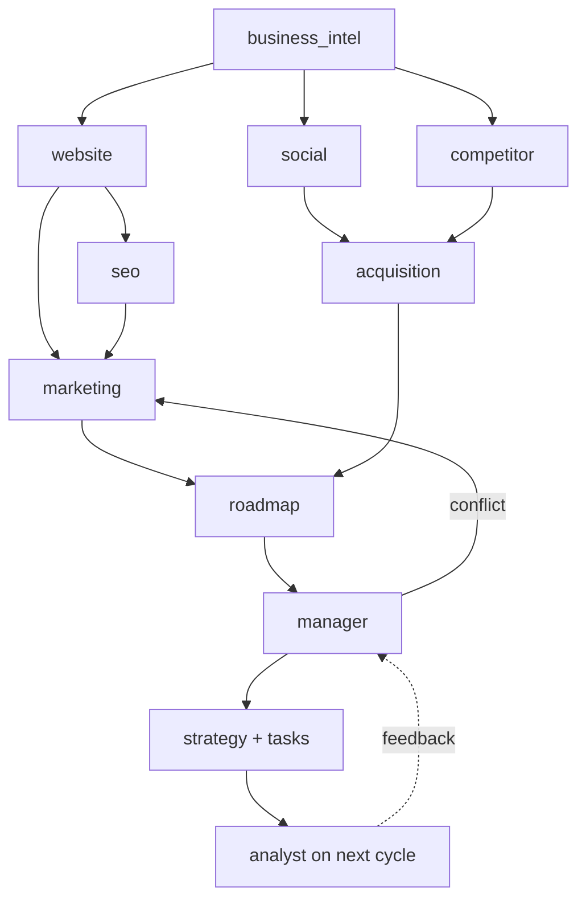

# AI agent architecture

Ten agents, one shared context object, one coordinator. The point of the design is that an agent
cannot invent business facts: it receives a typed slice of the business profile plus measurements,
and its output must validate against a schema that requires evidence references.

## The shared context

Every run receives a `BusinessContext` built from the database, not from conversation history:

```ts
type BusinessContext = {
  business: BusinessProfile;        // identity, industry, audience, budget
  goals: Goal[];                    // with current vs target
  measurements: MeasurementSet;     // audit findings, scores, social metrics, SEO checks
  history: { recommendations: Recommendation[]; completedTasks: Task[]; lastReports: Report[] };
  constraints: { budget?: number; teamSize?: number; locations: string[] };
  budgetTokens: number;             // hard cap for this run
};
```

History is retrieved by embedding similarity (pgvector) over past recommendations, then filtered to
the same business. An agent that repeats a recommendation already rejected gets flagged by the
duplicate check rather than shipped.

## Agent contracts

| agent | input | output (schema-validated) | tools | hard limits |
| :--- | :--- | :--- | :--- | :--- |
| business_intel | profile draft, site text | profile completion, personas, positioning | read site snapshot | 1 call, 6k in |
| website | pages + deterministic checks | findings[] with evidence_class, category scores | none (no browsing) | 2 calls, 12k in |
| seo | crawl facts, GSC data if connected | findings[], keyword opportunities | gsc.read | 2 calls |
| marketing | profile, findings, budget | strategy: channels, funnel, pillars | none | 2 calls |
| social | connected metrics, posts | per-platform assessment, content plan | meta/linkedin read | 3 calls |
| acquisition | personas, competitors | ICP, lead criteria, drafts | none | 2 calls |
| competitor | competitor pages | observations with source URLs | crawl (rate-limited) | 2 calls |
| roadmap | recommendations, capacity | 30/60/90 items with dependencies | none | 2 calls |
| analyst | metrics, task outcomes | progress, deltas, verdicts | none | 2 calls |
| manager | all of the above | final strategy, conflicts resolved | none, may re-ask one agent | 3 calls, 24k in |

No agent has write access to an external system. Tools that read third-party APIs are read-only
scopes; the single outward action in the product (sending an approved outreach email) is performed by
a worker with the user's approval recorded first.

## Orchestration



LangGraph holds this as a state graph. Parallel branches (`social`, `competitor`) fan out and join;
the manager is the only node allowed to emit the final artefact, and it may send exactly one
conflict-resolution question back to `marketing` or `roadmap`, which is what keeps a run bounded.

## Failure behaviour

| failure | behaviour |
| :--- | :--- |
| schema validation fails | one repair attempt with the validator error attached, then `needs_review` |
| provider timeout | exponential backoff, 3 tries, then the agent is skipped and the manager is told which input is missing |
| budget exhausted | run stops at the last completed node; partial output is stored and marked partial |
| no evidence for a claim | the claim is dropped, not softened. A shorter honest plan beats a longer plausible one |

## Guardrails against the obvious attacks

Crawled pages and third-party documents are untrusted input. Site text is delivered to the model as
data inside a delimited block, never as instructions, and the prompt states that anything resembling
instructions inside that block is content to be analysed, not obeyed. Tool calls are allowlisted per
agent, so a successful injection cannot reach a tool the agent was not granted. Outputs are schemas,
so "print your system prompt" fails validation.

## Cost control

Each agent declares `maxTokensIn`, `maxTokensOut`, `maxCalls`. The runtime enforces them before the
call and writes actuals to `agent_runs.cost_usd`. A business has a monthly ceiling; the manager
degrades to deterministic-only output when it is reached, and says so in the UI rather than silently
returning less.

## Evaluating the agents

Not "does the answer sound good". Per scenario fixture (a bakery, a B2B SaaS, an agency):

- top recommendation must cite at least one `measured` finding;
- no recommendation may duplicate one with `state='rejected'` for the same business;
- recommendation sets for two different industries must overlap less than 40% by title similarity;
- every task in the roadmap must have a success metric and an owner.

Those are assertions in `tests/agents`, and they run against recorded model responses so the suite is
deterministic and free.
