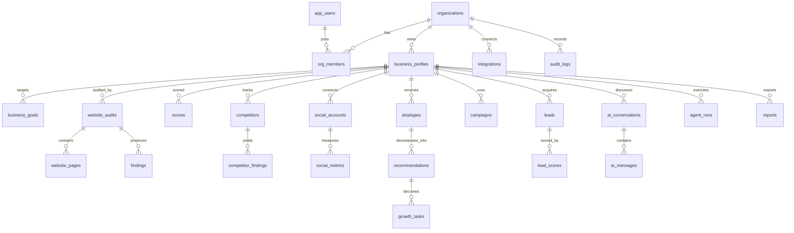

# Database schema

## Entity map

## Rules

**Every tenant table carries `org_id`.** Not `business_id` alone: a business can be re-parented, an
organisation cannot be escaped. Policies read `org_id`, and 24 of 26 tables are protected by them.

**`force row level security` on every tenant table.** Without `force`, the table owner bypasses
policies, so a migration or a maintenance script running as owner silently reads across tenants. The
isolation test connects as a plain role and asserts zero rows across the boundary.

**Scores never travel alone.** `scores` carries `methodology` and `inputs`, so a reviewer can
recompute 74/100 for SEO and see which checks contributed. A score without a method is a number that
cannot be argued with, which makes it useless in a strategy discussion.

**Evidence has a class, on every row that asserts something.** `findings`, `scores`,
`recommendations` and `competitor_findings` all carry `evidence_class`. The report renderer keys off
it, so a hypothesis cannot be printed in a findings section.

**Tokens are never stored.** `social_accounts.token_ref` and `integrations.token_ref` are opaque
pointers into the secret store. A database dump therefore contains no usable credential.

**Immutable history, mutable state.** `audit_logs` is append-only: RLS allows insert and select, and
`update`/`delete` are revoked. `recommendations` and `growth_tasks` mutate, and record prior state
through `audit_logs` rather than by overwriting silently.

**Notifications are per user, not per org broadcast.** `notifications.user_id` is nullable on purpose:
a null user means the whole org should see it, a set user means one person was addressed (an approval
request, a failed run they own). Read state is a timestamp, so "unread" is a query rather than a flag
that can drift.

**Money and ratios are `numeric`, not `float`.** `marketing_budget`, `campaigns.budget`, `cost_usd`.
Floats are fine for physics and wrong for invoices.

## Notable columns

| table.column | why it exists |
| :--- | :--- |
| `business_profiles.personas` | jsonb array; the manager agent reads and rewrites it as findings accumulate |
| `scores.methodology` | the formula in words, required, non-empty |
| `findings.source_url` | the page a finding came from, so a client can be shown it |
| `growth_tasks.depends_on` | uuid[] of task ids; the roadmap generator uses it for ordering |
| `agent_runs.cost_usd` | per-run spend, so the manager can enforce a per-business budget |
| `lead_scores.criteria` | the weights and per-criterion reasons, not just the total |
| `integrations.scopes` | requested scopes, so a disconnected integration can explain what it lost |

## Indexes that are not decoration

- `website_audits (status) where status in ('queued','crawling','analyzing')` - the worker's claim
  query stays small as history grows.
- `findings (business_id, category, severity)` - the dashboard's critical-problems list.
- `agent_runs (business_id, agent, created_at desc)` - "what did the SEO agent say last time".
- `audit_logs (org_id, created_at desc)` - the security view, which is read most during incidents.

## Migration policy

- One forward migration per change, numbered, committed with the code that needs it.
- Destructive changes ship in two steps: add nullable, backfill, then drop in a later release.
- `scripts/check_schema.py` runs in CI and fails on: SQL that does not parse, a tenant table without
  RLS, and a policy referencing a column that does not exist.
